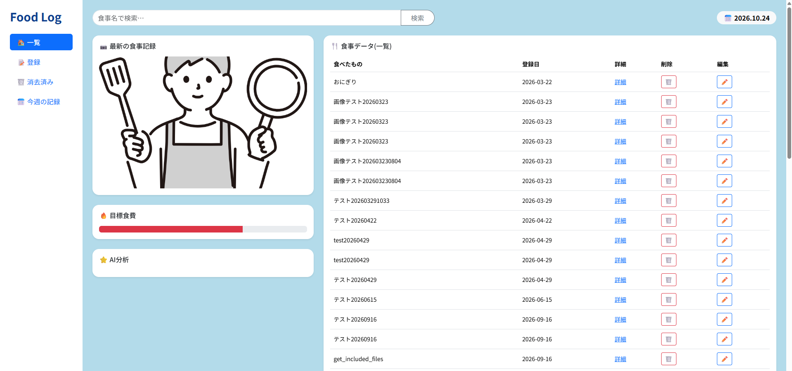
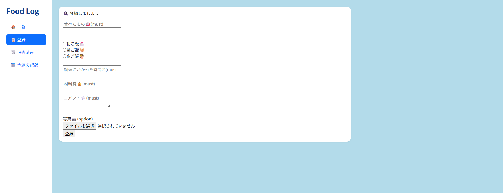
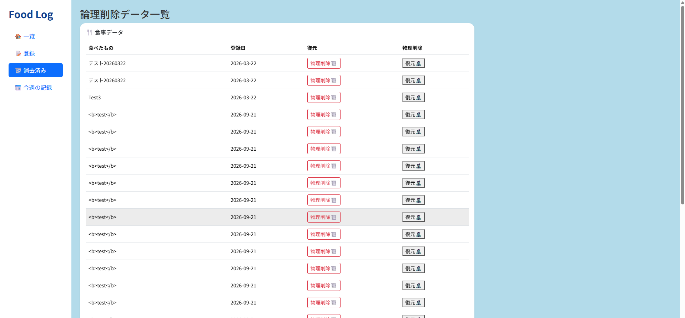
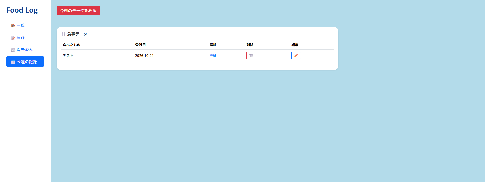

# このアプリは何のためのアプリか

・アプリ概要：日々の食事を管理し、自炊のモチベーションを上げたり食事の影響範囲を把握するためのWebアプリ(FoodLog)
<!--
別タブプレビュー
・Ctrl+Shift+V
リアルタイムプレビュー
・Ctrl+K →　V
 -->

# 誰向けのアプリか

・ペルソナ：自分（男性/20代前半/ITエンジニア/食費を4万に抑えたい）

# UI

- TOP(一覧)ページ

- データごとの詳細ページ

- 登録ページ

- 削除済みページ(復元・物理削除機能あり)

- 今週の記録のみの絞り込みページ

## 工夫したポイント

- 自分が直観的に良いなと思ったWebサイトからカラーコードやフォントを参考にしてUI作成
参考：https://umao.co.jp/

- ユーザの操作性を確認するため知り合いに操作して貰いFBを貰い修正
  - ボタンの大きさや絞り込み機能などを追加実装

### 実装機能

- 食事情報の登録・編集・削除機能
- 論理削除したデータの一覧とそれらの復元・物理削除機能
- 日数や食事名での絞り込み・検索機能

## 実装予定

- 今月・先月での絞り込み機能
- ページング機能
- 普段の自炊がより楽しくなるように目標の食費と今の差分を視覚化
- AIによる食材に対するアドバイス機能
- 目標食費と現在の食費との値を棒グラフにする。
- AIを用いた食費傾向のアドバイス機能
- テーブル整理

- 論理削除して30日たてば物理削除する自動削除機能実装

- SEO対策を考慮したタグ使用
- UX向上のため、JS用いてフロントエンド3割くらいさらにお洒落にする